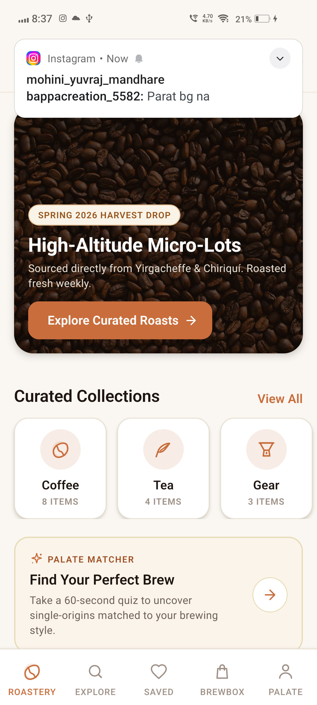
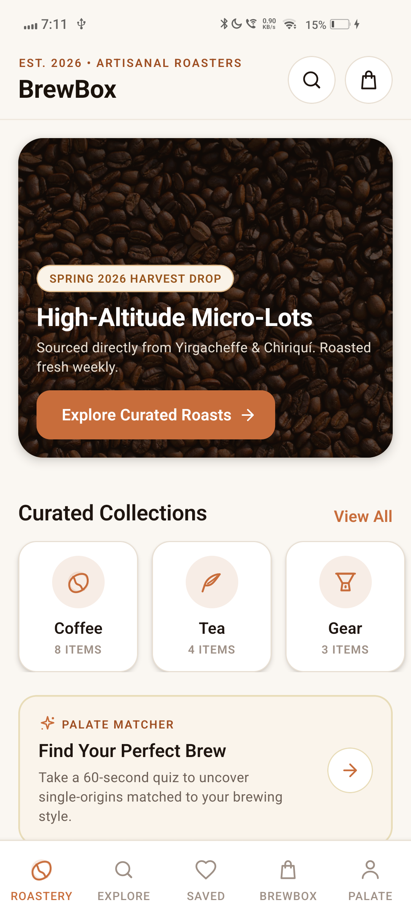
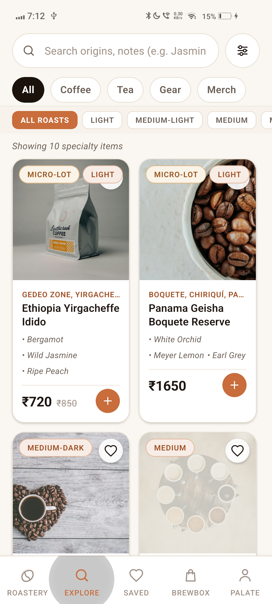
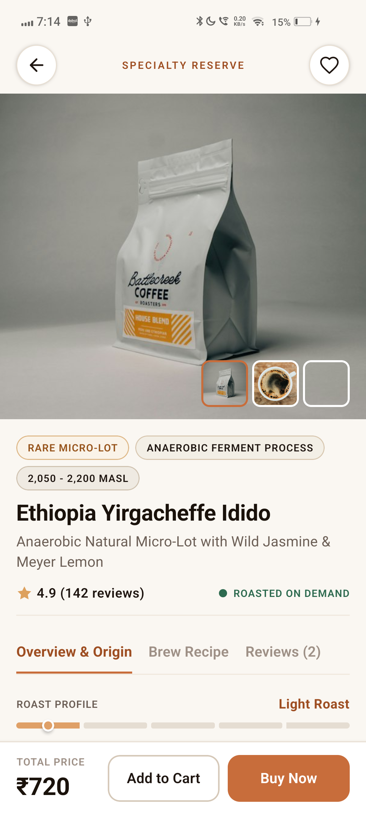
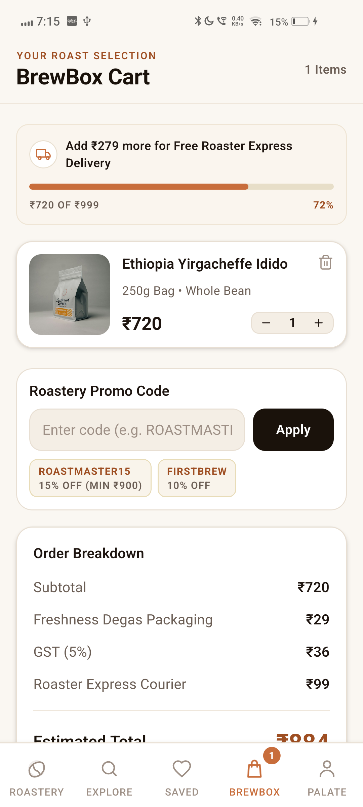
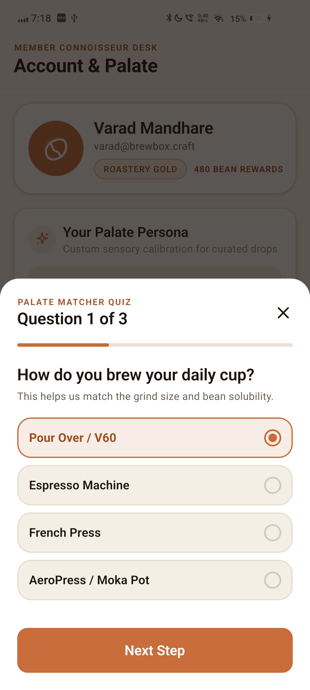
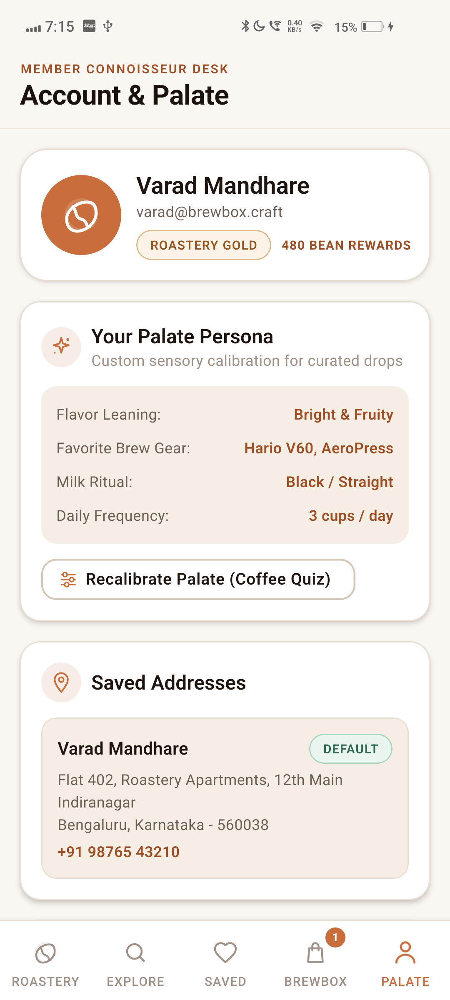

# ☕ BrewBox — Artisanal Specialty Coffee & Fine Tea Roastery

<div align="center">

[](https://reactnative.dev/)
[](https://www.typescriptlang.org/)
[](https://github.com/pmndrs/zustand)
[](https://developer.android.com/)
[](LICENSE)

**A bespoke, high-craft mobile e-commerce application crafted specifically for single-origin coffee connoisseurs, micro-lot enthusiasts, and ceremonial tea purists.**

[Explore Features](#-curated-features) • [Artisanal Design System](#-artisanal-design-system) • [Architecture](#-architecture--state-design) • [Offline APK Guide](#-standalone-offline-apk-build) • [Getting Started](#-getting-started)

<br/>



</div>

---

## 📖 Table of Contents

- [About BrewBox](#-about-brewbox)
- [Application Showcase (Live Device)](#-application-showcase-live-device)
- [🎓 CPAD Academic Jury Presentation](#-cpad-academic-jury-presentation)
- [Design Philosophy: Anti-AI Aesthetic](#-design-philosophy-anti-ai-aesthetic)
- [Curated Features](#-curated-features)
- [Sensory UI Components](#-sensory-ui-components)
- [Artisanal Design System](#-artisanal-design-system)
- [Architecture & State Design](#-architecture--state-design)
- [Project Structure](#-project-structure)
- [Standalone Offline APK Build](#-standalone-offline-apk-build)
- [Getting Started](#-getting-started)
- [Testing & Quality Assurance](#-testing--quality-assurance)
- [Roadmap & Integrations](#-roadmap--integrations)
- [Author & Acknowledgments](#-author--acknowledgments)

---

## 📱 Application Showcase (Live Device)

> Real device captures running the standalone release build on physical hardware (**Vivo 1919 / Android 12**):

| 🏠 Roastery Home | 🔍 Explore & Filter | ☕ Product Details & Dial-In |
|:---:|:---:|:---:|
|  |  |  |
| *Curated micro-lots, roast schedule banner & quick quiz card* | *Facet filtering across beans, teas, origins, roast levels & MASL* | *RoastMeter gauge, sensory radar, grind selector & brew recipe* |

| 🛒 Roastery Cart | 🧭 Palate Matcher Quiz | 👤 Palate Profile & Orders |
|:---:|:---:|:---:|
|  |  |  |
| *Free-shipping progress meter, promo validation & order breakdown* | *3-step interactive recommendation wizard for extraction & flavor* | *Palate profile attributes, 5-stage live order tracking & wishlist* |

---

## 🎓 CPAD Academic Jury Presentation

A 12-slide presentation developed specifically for the **Cross Platform Application Development (CPAD)** university jury examination, covering React Native architecture, state management patterns, and offline native compilation:

- 📊 **PowerPoint Deck:** [`BrewBox_Jury_Presentation.pptx`](./BrewBox_Jury_Presentation.pptx) *(16:9 Widescreen, Editable)*
- 📄 **PDF Presentation:** [`docs/BrewBox_Jury_Presentation.pdf`](./docs/BrewBox_Jury_Presentation.pdf) *(Ready for presentation/print)*
- 🖼️ **Slide Gallery (PNG):** [`docs/slides_png/`](./docs/slides_png/)

### Presentation Overview (12 Slides)

| Slide | Topic | CPAD Academic Focus |
|:---:|:---|:---|
| **01** | **Cover & Candidate Profile** | Title, academic course credentials, React Native 0.87 & Hermes engine tags |
| **02** | **Motivation & CPAD Paradigm** | Native Silos (Kotlin/Swift) vs Hybrid WebViews (Cordova/PWA) vs React Native |
| **03** | **CPAD Course Objectives** | 6 academic outcomes: cross-platform architecture, UI primitives, state, SVG, APK |
| **04** | **Technology Stack & Tooling** | React Native, TypeScript 6.0, Zustand 5.0, React Navigation 7, Gradle, Jest |
| **05** | **Topology & Navigation** | Navigation tree hierarchy, `SafeAreaProvider`, bottom tabs, modals & stack navigator |
| **06** | **Screens & Implementation** | 4-device breakdown: Home, Explore/Filter, Sensory Details, Roastery Cart |
| **07** | **State Management & Data Flow** | Context API vs Redux Toolkit vs Zustand 5.0 (atomic selectors, zero boilerplate) |
| **08** | **Styling & Yoga Flexbox Engine** | Flexbox layout engine in C++, design tokens, compiled StyleSheet caching, SVG pipeline |
| **09** | **Performance & Optimizations** | Hermes AOT bytecode, flat component hierarchy, FlatList virtualization, memory safety |
| **10** | **Native Build & Offline APK** | Standalone bundling, `assets/index.android.bundle`, `useDevSupport = false`, release APK |
| **11** | **Testing, Verification & Quality** | Strict TypeScript check (0 errors), ESLint (0 warnings), Jest unit tests (7/7 passed) |
| **12** | **Conclusion & Academic Takeaways** | Cross-platform code reuse, component architecture, state mastery, production APK |

---

## 🌿 About BrewBox

**BrewBox** is not a generic e-commerce template. Built from the ground up using **React Native 0.87** and **TypeScript 6.0**, it is designed to evoke the tactile, sensory atmosphere of premier third-wave roasteries and traditional tea houses (such as *Onyx Coffee Lab*, *Blue Bottle*, *Square Mile*, and *Ippodo Kyoto*).

From farm elevation metrics measured in **MASL** (Meters Above Sea Level), to experimental anaerobic fermentation indicators, 5-stage roast profiles, dynamic dial-in brewing guides, and a tailored **Palate Matcher Quiz**, BrewBox delivers an immersive shopping and educational experience for coffee and tea lovers.

---

## 🎨 Design Philosophy: Anti-AI Aesthetic

Most AI-generated mobile interfaces suffer from generic hallmarks: neon purple gradients, interchangeable stock cards, floaty glassmorphism, and disconnected visual hierarchies. 

BrewBox deliberately rejects this with a **handcrafted, editorial aesthetic**:

- **Earthy Terroir Palette**: Warm terracotta amber, deep roasted espresso obsidian, raw oat latte creams, and botanical Kyoto matcha greens.
- **Sensory & Scientific Precision**: Products celebrate authentic provenance — highlighting farm elevation (e.g., *2,100 MASL*), harvesting micro-climates, processing methods (washed, honey, anaerobic natural), and botanical cultivars (*Bourbon*, *Geisha*, *SL-28*).
- **Physical Roastery Identity**: Tactile components simulate physical roastery equipment — from visual flame roast meters to tactile grind dials calibrated for real brewing apparatuses.
- **Micro-Interaction Polish**: Dynamic free-shipping progress meters, order milestones modeled on real roasting batches, and interactive taste radar bars.

---

## ☕ Curated Features

### 1. Boutique Roastery Micro-Lots & Tea Estates
- **Single-Origin Showcase**: High-altitude specialty coffees sourced directly from Yirgacheffe, Boquete, Chikmagalur, and Gayo Highlands.
- **Ceremonial & Rare Teas**: Single-cultivar Kyoto Uji ceremonial matchas, charcoal-roasted Dong Ding oolongs, and first-flush Darjeeling teas.
- **Precision Gear**: Barista-grade extraction tools including ceramic V60 drippers, aeropress makers, and precision hand grinders.

### 2. Interactive "Palate Matcher" Quiz
- An interactive 3-step recommendation engine that diagnoses the user\'s preferred brewing method (Pour-Over, Espresso, Immersion), favorite flavor notes (Bright Floral, Fruity, Chocolate & Nutty, Deep Smoky), and milk habits to recommend the ideal roast match.

### 3. Step-by-Step Dial-In Brew Guides
- Each specialty offering features an integrated extraction recipe with exact coffee-to-water ratios, water temperature (°C), grind settings, and timed pour phases (bloom, agitation, draw-down).

### 4. Interactive Grind & Package Customizer
- Instant selection across **6 grind calibrations**: *Whole Bean*, *Espresso*, *Pour-Over / V60*, *AeroPress*, *French Press*, and *Cold Brew*.
- Multiple package sizing options (250g, 500g, 1kg) with real-time price updates.

### 5. Smart Roastery Cart & Checkout Engine
- **Complimentary Shipping Meter**: Real-time progress bar tracking order value toward the ₹999 free-shipping threshold.
- **Dynamic Promo System**: Validates promotional vouchers such as `ROASTMASTER15` (15% discount) and `FIRSTBREW` (₹150 off).
- **Eco-Packaging Toggle**: Option for 100% biodegradable compostable valve bags.
- **Roasting Schedule Guarantee**: Transparent notification of weekly small-batch roasting days (every Tuesday & Friday).

### 6. 5-Stage Live Roastery Tracking
Live order tracking modeled after boutique roasting workflows:
1. **Order Confirmed** — Green beans queued for batch roasting.
2. **Small-Batch Roasted** — Precision roasted on our Loring S15 Kestrel.
3. **Degassed & Flushed** — Nitrogen-flushed into one-way degassing valve bags.
4. **Dispatched** — Temperature-controlled express transit.
5. **Delivered to Cup** — Fresh roaster notes at peak flavor window.

---

## 🔬 Sensory UI Components

BrewBox includes a suite of custom-engineered sensory components in `src/components/`:

| Component | File | Purpose |
|---|---|---|
| **RoastMeter** | [`RoastMeter.tsx`](./src/components/product/RoastMeter.tsx) | 5-stage interactive roast gauge (Light Cinnamon → Medium-Dark → French Dark) with active pin pointer. |
| **TasteProfileBar** | [`TasteProfileBar.tsx`](./src/components/product/TasteProfileBar.tsx) | Visual sensory meters displaying Acidity, Sweetness, Body, and Bitterness scales. |
| **GrindSelector** | [`GrindSelector.tsx`](./src/components/product/GrindSelector.tsx) | Tactile pill selector with grind fineness labels and brewing apparatus recommendations. |
| **BespokeIcon** | [`BespokeIcon.tsx`](./src/components/common/BespokeIcon.tsx) | 30+ zero-dependency scalable SVG glyphs (coffee bean, V60 cone, French press, flame, leaf, truck). |
| **FreeShippingMeter** | [`FreeShippingMeter.tsx`](./src/components/cart/FreeShippingMeter.tsx) | Animated progress bar showing remaining cart value needed for complimentary shipping. |
| **ProductCard** | [`ProductCard.tsx`](./src/components/product/ProductCard.tsx) | Micro-lot badges, elevation tags, flavor chips, and quick-add actions with organic shadow elevation. |

---

## 🎨 Artisanal Design System

Located in `src/theme/`:

```
Terracotta Amber    #C86D3B  ██████  Primary brand accent & CTA buttons
Smoked Obsidian     #1A120B  ██████  Background & high-contrast typography
Latte Cream         #F9F6F0  ██████  Warm parchment surfaces & cards
Warm Sand           #EADBC8  ██████  Subtle borders & dividing accents
Matcha Sage         #2E4A35  ██████  Organic / botanical tea highlights
Deep Crema          #8B4513  ██████  Medium roasts & brewing indicators
Golden Honey        #D4A373  ██████  Micro-lot highlights & ratings
```

---

## 🏗️ Architecture & State Design

BrewBox utilizes a high-performance, unidirectional state management architecture powered by **Zustand 5.0**:

```
                       ┌─────────────────────────┐
                       │     App Entrypoint      │
                       │       (App.tsx)         │
                       └────────────┬────────────┘
                                    │
                       ┌────────────▼────────────┐
                       │  Navigation Root Stack  │
                       │   (BottomTab + Modals)  │
                       └──────┬────────────┬─────┘
                              │            │
            ┌─────────────────▼──┐      ┌──▼──────────────────┐
            │   Screen Views     │      │ Sensory Components  │
            │ (Home, Cart, etc.) │      │(RoastMeter, Icons)  │
            └─────────┬──────────┘      └──▲──────────────────┘
                      │                    │
                      │  Dispatches / Reads│
                      ▼                    │
         ┌─────────────────────────────────┴────────┐
         │              Zustand Stores              │
         ├──────────────────┬───────────────────────┤
         │ cartStore.ts     │ Cart items, discounts │
         │ wishlistStore.ts │ Saved favorites       │
         │ filterStore.ts   │ Catalog search/filter │
         │ userStore.ts     │ Orders & taste profile│
         └──────────────────────────────────────────┘
```

- **`cartStore`**: Handles item variants, grind styles, package weights, tax breakdown (5% GST), eco-packaging fees, and threshold math.
- **`wishlistStore`**: O(1) favorite lookup and instant "Move to Cart" transfers.
- **`filterStore`**: Multi-dimensional filtering by category, roast stage, micro-lot exclusivity, and sorting (Price, Rating, Elevation).
- **`userStore`**: User profile, saved addresses, taste preference tags, and live order generation with 5-stage timestamped pipeline milestones.

---

## 📁 Project Structure

```
BrewBox/
├── android/                   # Native Android project (CMake, NDK, Kotlin)
│   └── app/src/main/
│       ├── assets/            # Standalone offline JS bundle & assets
│       └── java/com/brewbox/  # Native Application & MainActivity
├── docs/                      # Documentation & assets
│   └── screenshots/           # Device preview captures
├── src/
│   ├── components/            # Reusable artisanal UI components
│   │   ├── cart/              # FreeShippingMeter, CartItemRow
│   │   ├── common/            # BespokeIcon, SearchBar, Badge
│   │   └── product/           # RoastMeter, TasteProfileBar, GrindSelector, ProductCard
│   ├── data/                  # Specialty catalog & dial-in brew guides
│   │   ├── products.ts        # 10 micro-lot coffees, teas & precision gear
│   │   ├── brewGuides.ts      # V60, AeroPress, French Press & Matcha dial-in steps
│   │   └── categories.ts      # Curated roastery collections
│   ├── navigation/            # React Navigation configuration
│   │   ├── BottomTabNavigator.tsx  # 5-tab bar with custom icons & badge counter
│   │   └── RootNavigator.tsx       # Native Stack with details & checkout screens
│   ├── screens/               # Screen implementations
│   │   ├── home/              # Roastery hero, featured micro-lots, collections
│   │   ├── explore/           # Search, roast filters, origin pills, sorting
│   │   ├── details/           # Specs, elevation, roast meter, brew guide, reviews
│   │   ├── cart/              # Items, promo codes, shipping meter, checkout CTA
│   │   ├── checkout/          # Address, roast schedule guarantee, payment selection
│   │   ├── wishlist/          # Saved items grid with move-to-cart
│   │   ├── orders/            # 5-stage live roastery batch tracking
│   │   └── profile/           # Gold membership, taste preferences, Palate Matcher
│   ├── store/                 # Zustand state management
│   ├── theme/                 # Color tokens, typography, spacing, shadows
│   └── types/                 # TypeScript interfaces (Product, Cart, Order, User)
├── __tests__/                 # Jest unit test suites
├── App.tsx                    # Root application component
├── index.js                   # React Native registry entry point
├── package.json               # NPM scripts & dependencies
└── tsconfig.json              # TypeScript strict configuration
```

---

## 📱 Standalone Offline APK Build

Unlike typical React Native development builds that require a running Metro server over USB, **BrewBox is packaged as a 100% standalone APK** that runs natively offline without any computer connection.

### How It Works:
1. **Pre-Compiled Bundle**:
   The JavaScript bundle and all vector assets are pre-packaged directly into the APK assets directory:
   ```bash
   npx @react-native-community/cli bundle \
     --platform android \
     --dev false \
     --entry-file index.js \
     --bundle-output android/app/src/main/assets/index.android.bundle \
     --assets-dest android/app/src/main/res/
   ```

2. **Standalone Configuration**:
   In `MainApplication.kt`, `useDevSupport` is set to `false`:
   ```kotlin
   override val reactHost: ReactHost
     get() = getDefaultReactHost(
       context = applicationContext,
       packageList = PackageList(this).packages.apply {},
       useDevSupport = false, // Always load from embedded APK bundle; never poll Metro
     )
   ```

3. **Install & Launch Directly on Phone**:
   ```bash
   # Build the debug APK with embedded assets
   cd android && ./gradlew assembleDebug

   # Stream install to connected device via ADB
   adb install -r app/build/outputs/apk/debug/app-debug.apk

   # Launch without Metro
   adb shell am start -n com.brewbox/.MainActivity
   ```

*You can disconnect the phone from USB immediately. The app will launch and run seamlessly anytime.*

---

## 🚀 Getting Started

### Prerequisites
- **Node.js**: `>= 22.11.0`
- **npm** or **yarn**
- **Android Studio** with Android SDK (API 34/35) & JDK 21
- Physical Android phone with USB Debugging enabled, or Android Emulator

### Installation & Setup

1. **Clone the Repository**:
   ```bash
   git clone https://github.com/Varadha9/BrewBox.git
   cd BrewBox
   ```

2. **Install Dependencies**:
   ```bash
   npm install
   ```

3. **Start the Development Server** (for live hot-reloading):
   ```bash
   npm start
   ```

4. **Run on Connected Device / Emulator**:
   ```bash
   npm run android
   ```

---

## 🧪 Testing & Quality Assurance

BrewBox is backed by strict TypeScript compilation, ESLint, and comprehensive Jest unit tests covering business logic, cart operations, discounts, and navigation rendering:

```bash
# Run TypeScript compilation check
npx tsc --noEmit

# Run ESLint quality check
npm run lint

# Run Jest unit test suites
npm test
```

### Test Suite Summary:
```
PASS  __tests__/cartStore.test.ts
  BrewBox Cart & Business Logic Tests
    ✓ should start with an empty cart and 0 count
    ✓ should add a specialty coffee item with selected grind and weight
    ✓ should unlock free shipping when subtotal exceeds ₹999 threshold
    ✓ should apply ROASTMASTER15 discount code correctly
    ✓ should reject promo if minimum order amount is not met
    ✓ should create a tracked order in userStore upon checkout

PASS  __tests__/App.test.tsx
  ✓ renders correctly

Test Suites: 2 passed, 2 total
Tests:       7 passed, 7 total
Snapshots:   0 total
```

---

## 🔮 Roadmap & Integrations

- [x] **Artisanal Design System** (terroir palette, editorial typography, tactile spacing)
- [x] **Sensory UI Components** (RoastMeter, TasteProfileBar, GrindSelector, BespokeIcon)
- [x] **Interactive Coffee Quiz** (Palate Matcher recommendation modal)
- [x] **Dial-In Brew Guides** (V60, AeroPress, French Press, Matcha)
- [x] **Zustand State Stores** (Cart, Wishlist, Filters, Orders)
- [x] **Standalone Offline APK Packaging** (`useDevSupport = false`)
- [ ] **Supabase Backend Integration** (PostgreSQL schema for orders, profiles, and live inventory)
- [ ] **Razorpay Payment Gateway** (Native SDK for UPI, Cards & Net Banking)
- [ ] **Push Notifications** (Alerts for newly dropped micro-lot seasonal roasts)

---

## 👤 Author & Acknowledgments

- **Creator & Lead Developer:** [Varad Vikas Mandhare](https://github.com/Varadha9)
- **Repository:** [github.com/Varadha9/BrewBox](https://github.com/Varadha9/BrewBox)
- **Inspiration:** Dedicated to the craft of specialty coffee farmers, small-batch roasters, and traditional tea artisans worldwide.

---

<div align="center">
  <sub>Crafted with passion for the perfect cup. © 2026 BrewBox Roastery.</sub>
</div>
